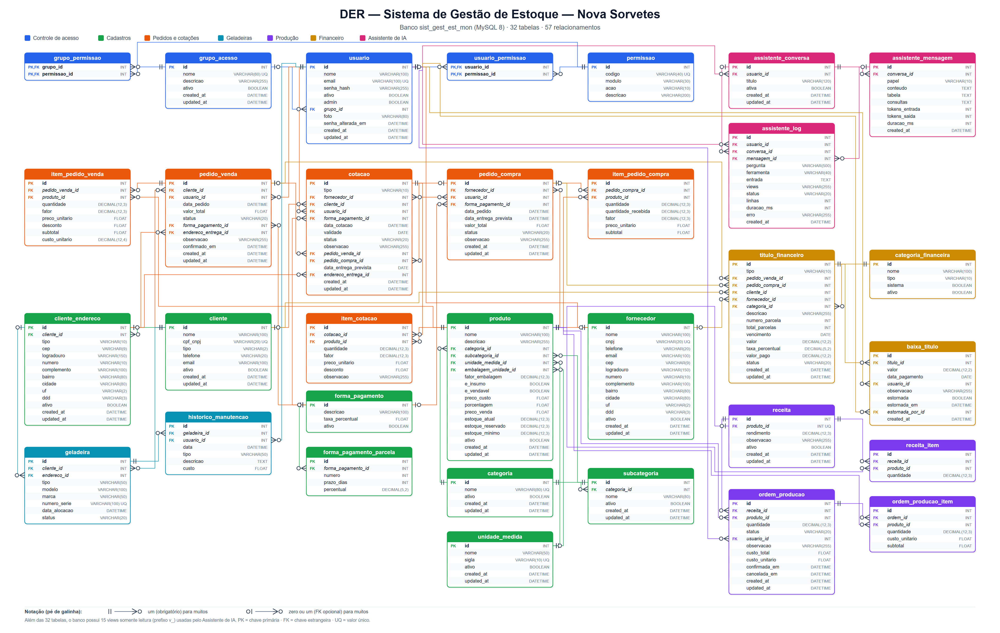

# Sistema de Gestão de Estoque e Monitoramento de Equipamentos

Sistema de gestão desenvolvido para a empresa [Nova Sorvetes](https://www.instagram.com/nova_sorvetes/), localizada em Itapira – SP, com o objetivo de substituir o controle manual por planilhas por uma solução informatizada, centralizada e rastreável: estoque, compras, vendas, produção, financeiro, equipamentos refrigerados e um assistente de IA para consultas em linguagem natural.


> **Status do projeto:** backend, frontend (todas as telas) e empacotamento em Docker concluídos. O sistema inteiro sobe com `docker compose up`.

---

## Sumário

- [Visão Geral](#visão-geral)
- [Módulos do Sistema](#módulos-do-sistema)
- [Modelo de Dados](#modelo-de-dados)
- [Regras de Negócio](#regras-de-negócio)
- [Arquitetura](#arquitetura)
- [Estrutura de Pastas](#estrutura-de-pastas)
- [Como Executar com Docker (recomendado)](#como-executar-com-docker-recomendado)
- [Como Executar sem Docker](#como-executar-sem-docker)
- [Variáveis de Ambiente](#variáveis-de-ambiente)
- [Migrações de Banco de Dados (Alembic)](#migrações-de-banco-de-dados-alembic)
- [Assistente de IA](#assistente-de-ia)
- [Solução de Problemas](#solução-de-problemas)
- [Roadmap](#roadmap)
- [Sobre o Projeto](#sobre-o-projeto)
- [Stack Utilizada](#stack-utilizada)

---

## Visão Geral

O sistema entrega uma solução funcional para o controle da operação de uma fábrica de sorvetes e do monitoramento dos equipamentos refrigerados (geladeiras e freezers) alocados nos clientes. Com ele, é possível:

- Controlar entradas e saídas de produtos via pedidos de compra e de venda, com **reserva automática de estoque**;
- Cadastrar clientes (com vários endereços) e fornecedores, com preenchimento automático de endereço via CEP;
- Registrar **cotações** de compra e de venda, comparar preços entre fornecedores e aprovar a cotação gerando o pedido;
- Cadastrar **formas de pagamento** com parcelas e taxas, que geram automaticamente as contas a pagar e a receber;
- Controlar o **financeiro**: títulos a pagar e a receber, baixas parciais com estorno, lançamentos avulsos e recorrentes;
- Cadastrar **receitas** e registrar **ordens de produção** que consomem insumos e dão entrada no produto fabricado, com custo calculado;
- Acompanhar o **dashboard** com receita, margem, resultado, caixa, previsão, inadimplência e rankings;
- Acompanhar os equipamentos alocados em cada cliente e o histórico de manutenção;
- Gerar **PDFs** de cotações e pedidos;
- Controlar o acesso por **grupos de permissões** (por módulo) e permissões extras por usuário;
- Fazer perguntas sobre os dados ao **Assistente de IA**, que só enxerga o que o usuário já poderia ver nas telas.

---

## Módulos do Sistema

| Módulo | Responsabilidade | Status |
|---|---|---|
| **Autenticação e acesso** | Login via JWT; grupos de acesso com permissões por módulo, permissões extras por usuário e perfil administrador | ✅ Completo |
| **Usuários** | Cadastro, grupo, administrador, permissões extras e foto de perfil (somente administrador) | ✅ Completo |
| **Cadastros** | Produtos (insumos e vendáveis), categorias, subcategorias, unidades de medida, clientes e fornecedores | ✅ Completo |
| **Pedidos de venda e de compra** | Reserva de estoque na venda, recebimento parcial na compra, endereço de entrega, geração de títulos | ✅ Completo |
| **Cotações** | Cotações de compra e de venda, comparativo de preços por produto e aprovação que gera o pedido | ✅ Completo |
| **Formas de pagamento** | Parcelas com prazo e percentual, taxa da modalidade | ✅ Completo |
| **Produção** | Receitas (com simulação) e ordens de produção com consumo de insumos e custo congelado | ✅ Completo |
| **Financeiro** | Contas a pagar e a receber, baixas parciais, estornos, categorias financeiras e lançamentos avulsos | ✅ Completo |
| **Dashboard e relatórios** | Resumo por competência, série mensal, comparativo, caixa realizado e previsto, inadimplência e rankings | ✅ Completo |
| **Geladeiras** | Equipamentos alocados em clientes e histórico de manutenção | ✅ Completo |
| **Assistente de IA** | Perguntas em linguagem natural sobre os dados, com 4 camadas de defesa e auditoria | ✅ Completo |
| **Documentos em PDF** | Cotação, pedido de venda e pedido de compra | ✅ Completo |
| **Frontend** | Interface web, redesenhada tela a tela | ✅ Completo |
| **Containerização** | Docker Compose: MySQL, API e Nginx | ✅ Completo |

---

## Modelo de Dados

O modelo relacional é composto por **32 tabelas**, distribuídas nos domínios abaixo (o schema inteiro é criado pelas migrations do Alembic):

- **Acesso:** `usuario`, `grupo_acesso`, `permissao`, `grupo_permissao`, `usuario_permissao`
- **Cadastros:** `categoria`, `subcategoria`, `unidade_medida`, `produto`, `cliente`, `cliente_endereco`, `fornecedor`, `forma_pagamento`, `forma_pagamento_parcela`
- **Vendas e compras:** `pedido_venda`, `item_pedido_venda`, `pedido_compra`, `item_pedido_compra`
- **Cotação:** `cotacao`, `item_cotacao`
- **Produção:** `receita`, `receita_item`, `ordem_producao`, `ordem_producao_item`
- **Financeiro:** `categoria_financeira`, `titulo_financeiro`, `baixa_titulo`
- **Monitoramento:** `geladeira`, `historico_manutencao`
- **Assistente de IA:** `assistente_conversa`, `assistente_mensagem`, `assistente_log`

Além das tabelas, o banco tem **15 views `v_*`** (somente leitura), que expõem os dados já com as regras de negócio aplicadas e **sem dados pessoais**. Elas são a única coisa que o Assistente de IA consegue consultar.

> O diagrama abaixo mostra as **32 tabelas** e os **56 relacionamentos** (chaves estrangeiras) do banco. Ele é gerado direto de `backend/models.py` pelo script `backend/scripts/gerar_der.py`, então reflete o schema real. A cor do cabeçalho indica o módulo; a notação é pé de galinha (`||` um, `o|` zero ou um, `o<` muitos).



### Produto

| Campo | Descrição |
|---|---|
| `id` | Chave primária |
| `nome`, `descricao`, `categoria_id`, `subcategoria_id`, `unidade_medida_id` | Identificação e categorização |
| `e_insumo`, `e_vendavel` | Define se entra em receitas (insumo) e/ou pode ser vendido |
| `preco_custo`, `porcentagem`, `preco_venda` | Precificação |
| `estoque_atual` | Quantidade física real, atualizada pelos pedidos e pela produção (até 3 casas decimais) |
| `estoque_reservado` | Quantidade comprometida em pedidos de venda ainda não confirmados |
| `estoque_minimo` | Base do alerta de estoque baixo |
| `ativo` | Soft delete |
| `created_at`, `updated_at` | Auditoria |

> O estoque disponível para venda é sempre `estoque_atual - estoque_reservado`, exposto na API como o campo computado `estoque_disponivel`.

### Cliente / Fornecedor

Dados cadastrais (`nome`, `cpf_cnpj`, `telefone`, `email`...) com validação de CPF/CNPJ, CEP, UF e DDD. O endereço é preenchido via [API ViaCEP](https://viacep.com.br/). Um cliente pode ter **vários endereços** (`cliente_endereco`), usados na entrega dos pedidos e na alocação das geladeiras. `ativo` é o soft delete.

### Pedido de Venda / Pedido de Compra

| Pedido | Status | Pontos principais |
|---|---|---|
| **Venda** | `aberto` → `confirmado` \| `cancelado` | Reserva estoque ao abrir; confirma a venda e congela o custo; endereço de entrega; forma de pagamento |
| **Compra** | `pendente` → `recebido` \| `cancelado` | Recebimento parcial e acumulativo por item; entrega prevista; forma de pagamento |

Cada pedido tem itens (`item_pedido_venda` e `item_pedido_compra`), o que evita repetir colunas no cabeçalho e mantém o modelo normalizado.

### Cotação

Cotação de **compra** (fornecedor) ou de **venda** (cliente). O ciclo muda conforme o tipo:

| Tipo | Status |
|---|---|
| **Compra** | `rascunho` → `enviada` → `recebida` → `aprovada` \| `recusada` (a cotação pode ir direto de `rascunho` a `recebida`) |
| **Venda** | `rascunho` → `enviada` → `aprovada` \| `recusada` (não há a etapa `recebida`) |

A recusa é possível em qualquer etapa antes da aprovação. Ao aprovar, o sistema gera o pedido correspondente na mesma transação. A cotação de venda guarda o endereço de entrega e a de compra, a entrega prevista.

### Forma de Pagamento

`descricao`, `taxa_percentual` e uma lista de **parcelas** (`prazo_dias` e `percentual`). As parcelas viram os vencimentos dos títulos financeiros.

### Produção

- **Receita:** produto fabricado, `rendimento` e itens (insumo + quantidade).
- **Ordem de produção:** `aberta` → `confirmada` \| `cancelada`; na confirmação grava o consumo real de cada insumo, o `custo_total` e o `custo_unitario`.

### Financeiro

- **Título financeiro:** uma parcela a pagar (compra) ou a receber (venda), ou um lançamento avulso (aluguel, energia, outras receitas...). Status `aberto` → `parcial` → `pago` \| `cancelado`.
- **Baixa:** pagamento ou recebimento, total ou parcial. O estorno não apaga: marca a baixa como estornada.

### Usuário e grupos de acesso

`usuario` (`nome`, `email`, `senha_hash` com bcrypt, `ativo`, `admin`, `grupo_id`, `foto`), `grupo_acesso` e as permissões efetivas. Veja [Controle de acesso](#controle-de-acesso).

### Geladeira / Histórico de Manutenção

O endereço da geladeira vem de um dos endereços do cliente ao qual ela está alocada. O `status` é `em_campo` \| `manutencao` \| `desativada`. Cada manutenção (`historico_manutencao`) registra data, tipo, descrição e custo.

---

## Regras de Negócio

Estas são as decisões de design que vão além de um CRUD simples e representam grande parte do valor técnico do projeto.

### Reserva de estoque em pedidos de venda

Sem controle de concorrência, dois pedidos abertos ao mesmo tempo para o mesmo produto poderiam, juntos, vender mais do que existe em estoque. Por isso o produto mantém dois contadores:

- `estoque_atual`: quantidade física real (só muda na efetiva entrada ou saída de mercadoria);
- `estoque_reservado`: soma das quantidades comprometidas em pedidos de venda `aberto`.

| Transição | Efeito no estoque |
|---|---|
| Criar pedido (`→ aberto`) | Valida `estoque_atual - estoque_reservado`; incrementa `estoque_reservado` |
| `aberto → confirmado` | Libera a reserva e debita o físico; congela o custo dos itens; gera as contas a receber |
| `aberto → cancelado` | Libera a reserva, sem afetar o físico |
| `confirmado → cancelado` | Devolve o físico e cancela os títulos (bloqueia se já houve recebimento) |

As linhas de produto são travadas (`SELECT ... FOR UPDATE`) durante a operação, então duas requisições simultâneas nunca reservam o mesmo saldo.

### Recebimento parcial e acumulativo em pedidos de compra

Cada item rastreia `quantidade` (pedida) separadamente de `quantidade_recebida` (acumulado). O endpoint `POST /pedidos-compra/{id}/receber` pode ser chamado várias vezes, sempre com a quantidade **daquela entrega**. O pedido fica `pendente` até todos os itens completarem a quantidade pedida e então vira `recebido` automaticamente. O cancelamento estorna do estoque exatamente o que foi recebido, com validação para não deixar o estoque negativo. As contas a pagar nascem junto com o pedido.

### Cotações

A comparação de preços considera só cotações de **compra** já respondidas (`recebida` ou `aprovada`) e itens com preço. A aprovação gera o pedido (compra ou venda, reservando estoque) **em uma única transação**: se o pedido não puder ser criado, por exemplo uma venda sem estoque, nada é gravado.

### Financeiro: títulos e baixas

- As parcelas da forma de pagamento viram títulos: a pagar na criação da compra e a receber na confirmação da venda.
- Uma baixa pode ser parcial; o título passa por `aberto → parcial → pago`. Estornar uma baixa a deixa registrada como estornada, sem apagá-la.
- Títulos e baixas são alterados com a linha do título travada, então duas baixas simultâneas nunca passam do saldo e uma baixa nunca atravessa o cancelamento do pedido.
- Títulos de pedido só são cancelados junto com o pedido; lançamentos avulsos podem ser editados e cancelados enquanto estiverem abertos e sem baixa. Lançamentos podem ser recorrentes (`1/N`, `2/N`...).

### Produção

O consumo de cada insumo é `quantidade_do_item × (quantidade_a_produzir ÷ rendimento)`, **arredondado para cima** na 3ª casa decimal: na dúvida, consome-se um milésimo a mais, nunca a menos. A mesma função alimenta a simulação da receita e a ordem de produção, então os dois sempre dão o mesmo número.

Ao **confirmar** a ordem, o sistema valida insumos e produto (ativos, e insumo marcado como tal), confere o saldo disponível de cada insumo, debita os insumos, dá entrada no produto fabricado e **congela** o consumo e o custo (`custo_total` e `custo_unitario`). Ordem aberta mostra apenas uma prévia. Cancelar uma ordem confirmada devolve os insumos e retira o produto fabricado (só se ele ainda tiver saldo para isso).

### Relatórios e dashboard

Os relatórios do financeiro seguem o **regime de competência**, a partir de uma única coleta de dados, de modo que o resumo e a série mensal sempre fecham:

- A venda conta quando **confirmada**; receita = subtotal dos itens (já com desconto);
- **CMV** = quantidade × custo unitário congelado na confirmação; margem bruta = receita − CMV;
- As compras aparecem como **investimento em estoque** e não entram no resultado, porque só viram custo quando o produto é vendido;
- Despesas e outras receitas = lançamentos avulsos não cancelados;
- **Resultado** = margem bruta + outras receitas − despesas.

Também existem o **fluxo de caixa realizado** (regime de caixa, pelas baixas e com a taxa estimada da forma de pagamento), o **fluxo previsto** (títulos em aberto por vencimento, com o que já venceu à parte), a **inadimplência por faixa de atraso** e os **rankings** de produtos, clientes e fornecedores. O Dashboard consome esses endpoints e mostra os destaques gerados a partir dos próprios números.

### Controle de acesso

- **Catálogo de 15 permissões**, no formato `<módulo>.<ver|editar>`. Os módulos são `cadastros`, `geladeiras`, `vendas`, `compras`, `cotacoes`, `producao`, `financeiro`, `relatorios` e `assistente`. `editar` já inclui `ver`.
- **Cadastros só tem `editar`:** a leitura dos cadastros é liberada a qualquer usuário logado, porque as telas de venda, compra e produção precisam listar produtos, clientes e fornecedores.
- **Permissão efetiva** = permissões do grupo (se ativo) + permissões extras do usuário. O administrador tem tudo, independentemente de grupo.
- **Grupos padrão** criados pelas migrations: *Gerência* (tudo), *Operacional* (operação, sem financeiro e relatórios) e *Consulta* (somente leitura operacional).
- Proteções: um administrador não desativa a própria conta nem remove a própria permissão de administrador; o sistema nunca fica sem administrador ativo; um grupo com usuários ativos não pode ser desativado.
- A proteção é aplicada em **dois níveis**: no frontend (redirecionamento e itens do menu) e no backend (cada router exige a permissão do seu módulo: `401` = não autenticado, `403` = sem permissão).

### Soft delete e auditoria

Cadastros (produtos, categorias, subcategorias, unidades de medida, clientes, fornecedores, formas de pagamento), receitas, categorias financeiras, usuários e grupos nunca são removidos: são marcados como `ativo = False`, preservando o histórico. Cada módulo expõe a consulta de inativos (`/inativos`) e a reativação, por `PATCH .../reativar` ou pela própria edição (`ativo: true`). Cotações e registros de manutenção, por não estarem ligados a transações efetivadas, permitem exclusão real. O Assistente de IA registra **toda** chamada em `assistente_log`.

---

## Arquitetura

```
Navegador
   │
   ▼
Frontend (HTML/CSS/JS puro, servido pelo Nginx)  ──►  http://localhost:8080
   │  requisições HTTP/JSON com token JWT
   ▼
Backend (FastAPI)                                 ──►  http://localhost:8000  (Swagger em /docs)
   ├── routes/      → Endpoints REST, um arquivo por módulo
   ├── schemas/     → Validação de entrada e saída (Pydantic v2)
   ├── core/        → Regras de negócio, segurança (JWT), PDFs, relatórios e assistente de IA
   └── models.py    → Mapeamento ORM (SQLAlchemy 2)
   │
   ▼
Banco de Dados (MySQL 8)                          ──►  localhost:3307 (opcional, para ferramentas externas)
```

No frontend, cada tela tem seu HTML em `pages/`, sua lógica em `js/pages/` e uma camada `js/services/` que concentra todas as chamadas à API. Componentes compartilhados (menu lateral, modais, gráficos em SVG, seletor de permissões) ficam em `js/components/`.

---

## Estrutura de Pastas

```
sist_gest_est_mon/
├── backend/
│   ├── alembic/                   # Migrações de schema do banco de dados
│   │   └── versions/
│   ├── core/                      # Regras de negócio e infraestrutura
│   │   ├── assistente/            # Assistente de IA (orquestrador, SQL seguro, defesas, provedor)
│   │   ├── security.py            # Autenticação JWT
│   │   ├── permissoes.py          # Catálogo de permissões e dependências das rotas
│   │   ├── pedidos.py, estoque.py, financeiro.py, receita.py, pagamento.py
│   │   └── relatorios*.py, pdf.py, foto.py, validacoes.py
│   ├── docker/                    # Script de entrada e preparação do banco (usado pelo Docker)
│   ├── routes/                    # Endpoints da API, um arquivo por módulo
│   ├── schemas/                   # Modelos Pydantic de entrada e saída
│   ├── scripts/                   # Avaliação do assistente, gerador do DER e scripts de apoio
│   ├── Dockerfile
│   ├── alembic.ini
│   ├── database.py                # Conexão com o MySQL
│   ├── models.py                  # Modelos ORM (SQLAlchemy)
│   ├── main.py                    # Inicialização da aplicação FastAPI
│   └── requirements.txt           # Dependências do projeto
├── frontend/
│   ├── assets/images/             # Logotipos, ilustração do login e o DER
│   ├── css/                       # Folhas de estilo (base, sidebar e uma por tela)
│   ├── js/
│   │   ├── core/                  # api.js, auth.js, config.js, formatadores.js, mascaras.js
│   │   ├── components/            # sidebar, feedback, gráficos, modais e formulários compartilhados
│   │   ├── pages/                 # Lógica específica de cada tela
│   │   └── services/              # Comunicação com a API (um arquivo por módulo)
│   └── pages/                     # HTML de cada tela
├── docker/
│   └── frontend/                  # Dockerfile e nginx.conf do frontend
├── backups/                       # Dumps do banco (não versionados)
├── docker-compose.yml             # Modo "pronto para rodar" (banca/produção)
├── docker-compose.dev.yml         # Complemento para desenvolver com recarga automática
├── .env.example                   # Modelo das variáveis do Docker
├── .dockerignore
├── .gitattributes
├── .gitignore
└── README.md
```

---

## Como Executar com Docker (recomendado)

Sobe o sistema completo (MySQL, API e frontend) com um comando, sem instalar Python nem MySQL.

**Pré-requisito:** [Docker Desktop](https://www.docker.com/products/docker-desktop/) em execução (no Windows, com WSL 2).

### 1. Configurar o `.env`

Na raiz do repositório:

```powershell
Copy-Item .env.example .env       # Linux/Mac: cp .env.example .env
```

Abra o `.env` e troque, no mínimo: `DB_PASSWORD`, `MYSQL_ROOT_PASSWORD`, `SECRET_KEY`, `ADMIN_EMAIL` e `ADMIN_SENHA` (de 8 a 72 caracteres). Use senhas apenas com letras e números, sem `$ % # " '` ou espaços. `DB_USER` **não** pode ser `root`. O arquivo `.env` nunca é versionado.

### 2. Subir

```powershell
docker compose up -d --build
```

Na primeira vez as imagens são baixadas e construídas (alguns minutos). Ao iniciar, o backend espera o banco, aplica as migrations, cria o usuário MySQL somente leitura do assistente de IA e o administrador inicial (só se o banco não tiver nenhum usuário). Acompanhe com `docker compose logs -f backend`.

| Serviço | Endereço |
|---|---|
| Sistema (frontend) | http://localhost:8080 (redireciona para o login) |
| API e documentação (Swagger) | http://localhost:8000/docs |
| MySQL (opcional, DBeaver etc.) | `localhost:3307`, com o `DB_USER` e `DB_PASSWORD` do `.env` |

Entre com o `ADMIN_EMAIL` e a `ADMIN_SENHA` definidos no `.env`.

### 3. Comandos do dia a dia

```powershell
docker compose ps                       # situação dos containers
docker compose logs -f backend          # log da API
docker compose stop                     # para (mantém os dados)
docker compose up -d                    # sobe de novo
docker compose down                     # remove os containers (os dados continuam nos volumes)
docker compose down -v                  # CUIDADO: apaga também o banco e as fotos
docker compose up -d --build            # reconstrói as imagens após mudar o código (modo padrão)
```

Os containers usam `restart: unless-stopped`: voltam sozinhos quando o Docker Desktop abre, a não ser que você os tenha parado. Também é possível iniciar e parar o grupo `nova-sorvetes` pela aba **Containers** do Docker Desktop (os botões ▶ e ■).

### 4. Modo desenvolvimento (código espelhado e recarga automática)

```powershell
docker compose -f docker-compose.yml -f docker-compose.dev.yml up --build
```

As pastas `backend/` e `frontend/` ficam espelhadas nos containers: ao salvar um `.py`, o uvicorn recarrega sozinho; no frontend basta dar F5. Só é preciso `--build` de novo se mudar o `requirements.txt` ou um Dockerfile. Nesse modo, uma migration gerada dentro do container aparece na sua pasta:

```powershell
docker compose exec backend alembic revision --autogenerate -m "descricao da mudanca"
docker compose exec backend alembic upgrade head
```

> No modo desenvolvimento, se existir um `backend/.env` local, ele também é lido dentro do container; as variáveis do `.env` da raiz têm prioridade.

### 5. Backup e restauração do banco

```powershell
# Backup (gera backups/backup_AAAA-MM-DD.sql; arquivos backup_*.sql não são versionados)
docker compose exec -T db sh -c 'mysqldump -uroot -p"$MYSQL_ROOT_PASSWORD" --routines "$MYSQL_DATABASE" > /tmp/backup.sql'
docker compose cp db:/tmp/backup.sql backups/backup_2026-01-01.sql

# Restauração de um dump seu (substitui o conteúdo atual do banco)
docker compose cp backups/backup_2026-01-01.sql db:/tmp/restaurar.sql
docker compose exec db sh -c 'mysql -uroot -p"$MYSQL_ROOT_PASSWORD" "$MYSQL_DATABASE" < /tmp/restaurar.sql'
docker compose restart backend
```

---

## Como Executar sem Docker

**Pré-requisitos:** Python 3.12+, MySQL 8 e Git.

```bash
# 1. Clonar o repositório
git clone <url-do-repositorio>
cd sist_gest_est_mon/backend

# 2. Criar e ativar o ambiente virtual
python -m venv venv
venv\Scripts\activate        # Windows
# source venv/bin/activate   # Linux/Mac

# 3. Instalar as dependências
pip install -r requirements.txt

# 4. Criar o arquivo backend/.env (veja "Variáveis de Ambiente"), com DB_HOST=localhost.
#    SECRET_KEY e ALGORITHM (HS256) são obrigatórios; MYSQL_ROOT_PASSWORD e ADMIN_* são só do Docker

# 5. Criar o banco de dados no MySQL
# CREATE DATABASE sist_gest_est_mon CHARACTER SET utf8mb4 COLLATE utf8mb4_unicode_ci;

# 6. Criar as tabelas, as views e os dados de base (grupos, permissões, categorias financeiras)
alembic upgrade head

# 7. Subir o servidor
uvicorn main:app --reload
```

A documentação interativa da API fica em `http://127.0.0.1:8000/docs`.

**Primeiro usuário:** com o banco sem nenhum usuário, o `POST /usuarios/` é liberado para criar o primeiro administrador (pelo Swagger, enviando `"admin": true`). Depois disso, só administradores cadastram usuários.

**Frontend:** sirva a pasta `frontend/` por qualquer servidor HTTP estático (por exemplo, o Live Server do VS Code) e abra `pages/login.html`. O frontend procura a API na **porta 8000 do mesmo endereço** em que foi aberto.

**Assistente de IA (opcional):** crie o usuário MySQL somente leitura com `backend/scripts/criar_usuario_ia.sql` (ajuste senha e nome do banco) depois do `alembic upgrade head`, e preencha as variáveis `IA_*` e `GEMINI_API_KEY`.

---

## Variáveis de Ambiente

O modelo completo está em `.env.example` (Docker, na raiz). Sem Docker, as mesmas variáveis vão em `backend/.env`.

| Variável | Descrição |
|---|---|
| `DB_HOST`, `DB_PORT`, `DB_NAME`, `DB_USER`, `DB_PASSWORD` | Conexão com o MySQL. No Docker, `DB_HOST` é forçado para `db` |
| `MYSQL_ROOT_PASSWORD`, `MYSQL_ROOT_USER` | Senha do root do MySQL (Docker; também usada para criar o usuário da IA). `MYSQL_ROOT_USER` é opcional (padrão `root`) |
| `SECRET_KEY`, `ALGORITHM`, `ACCESS_TOKEN_EXPIRE_HOURS` | Assinatura e validade do token JWT. `SECRET_KEY` e `ALGORITHM` (`HS256`) são obrigatórios; a validade padrão é 8 horas |
| `ADMIN_NOME`, `ADMIN_EMAIL`, `ADMIN_SENHA` | Administrador inicial (Docker; criado só se não houver usuários) |
| `EMPRESA_NOME`, `EMPRESA_CNPJ`, `EMPRESA_ENDERECO`, `EMPRESA_TELEFONE`, `EMPRESA_EMAIL` | Cabeçalho dos PDFs |
| `UPLOADS_DIR` | Pasta das fotos de usuários (no Docker, um volume em `/data/uploads`) |
| `IA_HABILITADO`, `GEMINI_API_KEY`, `IA_MODELO` | Liga o assistente e define a chave e o modelo |
| `IA_MODELO_RESERVA`, `IA_RACIOCINIO` | Opcionais: modelos de reserva (lista separada por vírgula, usados se o principal estiver fora do ar) e esforço de raciocínio (`low` por padrão) |
| `IA_DB_USER`, `IA_DB_PASSWORD` | Usuário MySQL somente leitura do assistente |
| `IA_MODO_PRIVADO` | `true`: os dados das consultas não são enviados ao provedor, só nomes de colunas e número de linhas |
| `IA_LIMITE_POR_HORA`, `IA_MAX_PASSOS`, `IA_MAX_LINHAS`, `IA_TIMEOUT_SEGUNDOS`, `IA_TIMEOUT_PROVEDOR` | Limites de uso, de rodadas de ferramenta, de linhas e de tempo |

---

## Migrações de Banco de Dados (Alembic)

O schema é versionado com [Alembic](https://alembic.sqlalchemy.org/): uma migration *baseline* cria o schema inteiro e as demais acrescentam os módulos seguintes, incluindo dados de base (grupos de acesso, permissões, categorias financeiras) e as views do assistente. Um banco vazio mais `alembic upgrade head` é suficiente para começar.

```bash
# Gerar uma nova migração após alterar models.py
alembic revision --autogenerate -m "descricao da mudanca"

# Revisar o arquivo gerado em alembic/versions/ antes de aplicar

# Aplicar a migração ao banco
alembic upgrade head
```

> **Nota técnica:** se a senha do banco contiver `%`, ele precisa ser escapado como `%%` na URL de conexão do `alembic/env.py`, pois o `configparser` do Python interpreta `%` como interpolação (o `env.py` já faz isso).

---

## Assistente de IA

O assistente responde perguntas em linguagem natural ("quais clientes estão com títulos vencidos?") consultando o banco por meio de um modelo de linguagem (Google Gemini). Ele foi desenhado para ser seguro mesmo que o modelo erre:

1. **Banco:** o usuário MySQL `sistema_ia` só tem `SELECT` nas 15 views, em sessão somente leitura, com limite de tempo e de linhas.
2. **Views:** documentadas, com as regras de negócio embutidas e **sem dados pessoais** (sem CPF/CNPJ, telefone, e-mail, endereço completo, senhas ou observações livres).
3. **Validador de SQL:** lista de permissões (*whitelist*). Só passa um único `SELECT` sobre as views; o SQL executado é **regerado a partir da árvore sintática**, nunca o texto original.
4. **Escopo por permissão:** cada view pertence a um módulo e exige `<módulo>.ver`, então a IA só consulta o que o usuário já veria nas telas.

Cada chamada é auditada em `assistente_log` (consulta pelo endpoint `GET /assistente/auditoria`, restrito a administradores) e há limite de perguntas por hora. O resultado das consultas é tratado como dado, nunca como instrução. O script `backend/scripts/avaliar_assistente.py` roda uma avaliação com 20 perguntas básicas e 11 avançadas, mais verificações determinísticas das camadas de defesa. O assistente fica desligado sem `GEMINI_API_KEY` ou com `IA_HABILITADO=false`.

---

## Solução de Problemas

| Sintoma | Causa provável e solução |
|---|---|
| `env file ... .env not found` | Falta criar o `.env`: `Copy-Item .env.example .env` |
| `required variable ... is missing a value` | Variável obrigatória vazia no `.env` (`DB_NAME`, `DB_USER`, `DB_PASSWORD` ou `MYSQL_ROOT_PASSWORD`) |
| `port is already allocated` | Outro programa usa a porta (8080, 8000 ou 3307). Pare-o ou, para o MySQL, apague a linha `"3307:3306"` do compose |
| Backend reinicia sem parar | Veja `docker compose logs backend`. Causa comum: senha do `.env` com `$`, `%` ou aspas |
| Mudei a senha do banco no `.env` e deu erro de acesso | O MySQL só lê as senhas na **primeira** criação do volume. Recrie com `docker compose down -v` (apaga os dados) |
| `exec ... no such file or directory` ao iniciar | Fim de linha CRLF em script `.sh`. O `.gitattributes` do projeto força LF: refaça o checkout do arquivo |
| Tela abre mas diz que não conectou ao servidor | A API não está de pé em `http://<mesmo-endereço>:8000`. Confira `docker compose ps` |
| O uvicorn não recarrega no Windows (modo dev) | O `docker-compose.dev.yml` já força *polling*; confirme que usou os dois arquivos `-f` |
| Assistente de IA indisponível | Sem `GEMINI_API_KEY`, com `IA_HABILITADO=false` ou sem o usuário `IA_DB_USER` (veja o log do backend) |

---

## Roadmap

### Concluído

Backend completo com regras de negócio e controle de acesso por grupos; frontend redesenhado tela a tela (login, cadastros, pedidos, cotações, produção, formas de pagamento, financeiro, geladeiras, grupos de acesso, assistente de IA, usuários e dashboard); assistente de IA com avaliação; empacotamento em Docker; diagrama ER atualizado e gerado a partir dos modelos.

### Evoluções futuras

Acesso via aplicativo móvel, monitoramento de temperatura das geladeiras por sensores IoT, troca de senha pelo próprio usuário, tela de auditoria do assistente de IA para administradores (o endpoint já existe) e restrição do CORS aos endereços do sistema.

---

## Sobre o Projeto

Este sistema foi desenvolvido como Trabalho de Conclusão de Curso (TCC) da [UniFAJ](https://unifaj.grupounieduk.com.br/), com o objetivo de aplicar em um caso real os conceitos estudados ao longo da graduação.

---

## Stack Utilizada

<div style="display: flex; flex-wrap: wrap; gap: 8px;">


</div>
